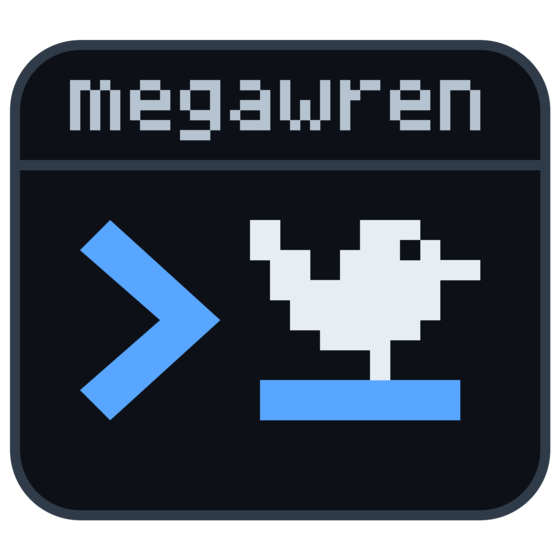
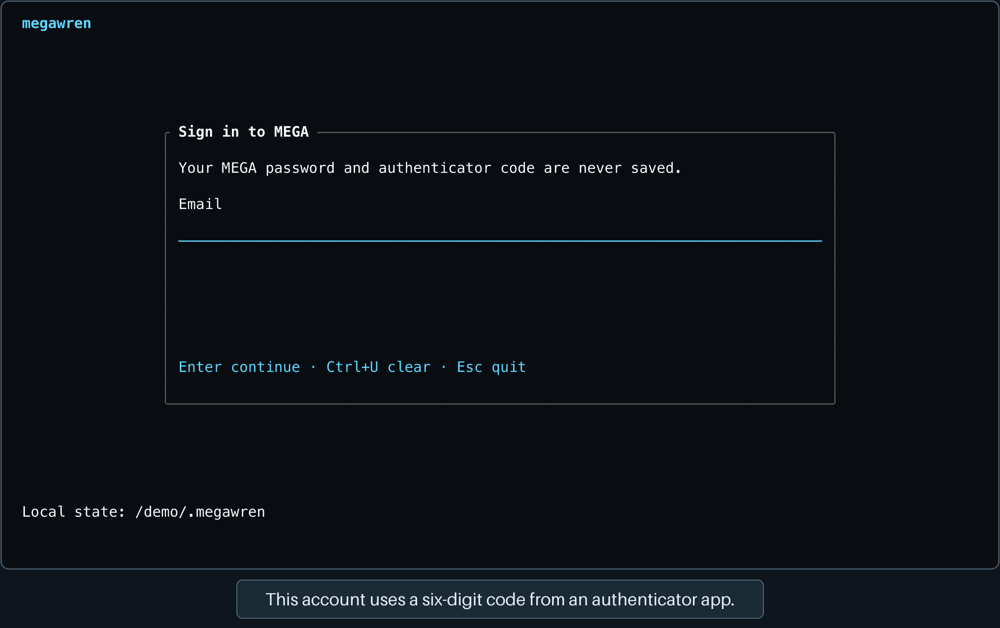

<p align="center">
  
</p>

# Megawren - MEGA terminal client (tui) for macOS and Linux

Megawren is a MEGA terminal client for MEGA on macOS 15 or later and Linux. It uses the official MEGA SDK and runs without a background service.

## Features

- Sign in with two-factor authentication. Save your login with an optional local passphrase.
- Upload and download files or folders, and keep working while they transfer. Follow or cancel each transfer.
- Rename, move, or copy selected items. Restore files and folders from the Rubbish Bin.
- Preview text files and images on request.
- Use `ls`, `get`, and `put` in scripts. `ls --json` gives a machine-readable listing.

[](docs/media/megawren.gif?raw=true)

## Install

| Method | Command |
| --- | --- |
| Homebrew, macOS or Linux | `brew install def324/tap/megawren` |
| Install script, macOS or Linux (including NAS) | `curl -fsSL https://def324.github.io/megawren/install.sh \| sh` |
| Debian, Ubuntu, Raspberry Pi OS | `sudo apt install ./megawren_*.deb` after downloading the `.deb` |
| Fedora, RHEL, openSUSE | `sudo dnf install ./megawren-*.rpm` after downloading the `.rpm` |
| Docker or Podman | `docker run -it --rm -v megawren:/data ghcr.io/def324/megawren` |

Packages and archives are on the [releases page](https://github.com/def324/megawren/releases/latest). The Linux builds are statically linked and need no system libraries, so they run on any x86-64 or ARM64 Linux, including NAS systems.

**The install script** puts Megawren in `~/.local/bin` without `sudo` and checks the download's SHA-256 checksum. Run it again to upgrade. Pass `--version X.Y.Z` for a specific release or `--prefix DIR` to install elsewhere. Run it with `--help` for all options.

**The container** keeps your saved login and file index in the `megawren` volume. Leave out `-it` to run commands from a script, for example `docker run --rm -v megawren:/data ghcr.io/def324/megawren ls /Reports`. To download into a folder on the host, mount it with `-v "$PWD:/downloads"` and pass `/downloads` as the destination.

**An archive** works on its own. Extract it and run `bin/megawren`. On macOS, keep `bin/` and `lib/` together.

### Uninstall

| Installed with | Remove the program |
| --- | --- |
| Install script | `~/.local/share/megawren/uninstall.sh` |
| Homebrew | `brew uninstall megawren` |
| `.deb` | `sudo apt remove megawren` |
| `.rpm` | `sudo dnf remove megawren` |
| Docker or Podman | `docker image rm ghcr.io/def324/megawren` |

Removing the program keeps your saved login and file index in `~/.megawren`, so a reinstall picks up where you left off. To remove those too:

- With the install script, run `~/.local/share/megawren/uninstall.sh --purge`. It signs out of MEGA, deletes `~/.megawren`, and then removes the program.
- Otherwise, run `megawren logout` first so the saved session ends on MEGA's servers, then delete `~/.megawren`. For the container, run `docker run -it --rm -v megawren:/data ghcr.io/def324/megawren logout`, then `docker volume rm megawren`.

If the uninstaller is gone, the install script can do the same: `curl -fsSL https://def324.github.io/megawren/install.sh | sh -s -- --uninstall --purge`. Leave out `--purge` to keep `~/.megawren`. If you installed with `--prefix`, pass the same prefix.

### Verify a download

From 0.3.0 on, every release file and the container image carry a signed build attestation. It records the repository, commit, and workflow that built them, and it's logged publicly. With the [GitHub CLI](https://cli.github.com), check a file or the image like this:

```sh
gh attestation verify megawren-X.Y.Z-x86_64-unknown-linux-musl.tar.gz --repo def324/megawren
gh attestation verify oci://ghcr.io/def324/megawren:X.Y.Z --repo def324/megawren
```

Each release also includes `megawren-X.Y.Z.intoto.jsonl`, which holds the attestations of all its files. Download it next to a file and add `--bundle megawren-X.Y.Z.intoto.jsonl` to check the file without fetching its attestation from GitHub.

Each archive also comes with an SBOM (`.cdx.json`) that lists every library inside it, including the bundled C libraries. The program itself carries its list of Rust dependencies, so `cargo audit bin` can check an installed copy, for example `cargo audit bin ~/.local/bin/megawren`. To report a security problem, see the [security policy](SECURITY.md).

## Usage

### Start Megawren

Open a terminal and run `megawren`. If you unpacked an archive instead of installing, run `./bin/megawren` from its folder. Megawren fills the terminal window and lists the files and folders in your MEGA account, starting with **Cloud drive**, MEGA's name for your main storage.

The first time, sign in with your MEGA email and password, plus the six-digit code from your authenticator app if your account uses two-factor authentication. Megawren then asks whether to save the login on this computer:

- **Don't save** signs you out when you quit, so you sign in again next time.
- **Save login** keeps you signed in. You can protect the saved login with a local passphrase, which Megawren then asks for when it starts. Without one, anyone who can read your files on this computer can get into your MEGA account.

A large account can take a while to load the first time. A saved login also keeps an encrypted copy of your file list, so later starts are faster.

### Find your way around

Use ↑ and ↓ to move, Enter to open a folder, and ← to go back. Press **i** to see a folder's details and what you can do with it, without opening it. Enter on a file shows the same. To work on several items at once, mark each one with Space, then press Enter. **?** lists every shortcut, and **q** quits.

| To | Do this |
| --- | --- |
| Download | Pick a file, or mark several. Press **d**, go to the folder on your computer where they should go, then press **d** again. |
| Upload | Open the MEGA folder they should go into. Press **u**, mark the files or folders on your computer with Space, then press **u** again. |
| Preview a file | Press **p**. **Esc** closes the preview. To open one file directly, run `megawren preview /path/to/file`. |
| Follow transfers | Press **t** to see each file and its progress. ↑ and ↓ show where each one is going. **x** cancels the selected transfer, or the whole batch if you started several files together. **Shift+X** cancels everything. Both ask first. |
| Delete | Press **Delete** to move the selection to the Rubbish Bin. Megawren asks first. |
| Restore something you deleted | Press **2** to open the **Rubbish Bin**. Mark the item, press Enter, and choose **Restore to original folder**. Press **1** to return to **Cloud drive**. |

Previews load only when you ask for one. For text files up to 1 MiB, the preview shows up to the first 128 KiB. JPEG, PNG, WebP, and GIF images up to 100 MiB are supported. If file icons show up as empty squares, your terminal font lacks them. Press **F3** to switch to plain icons.

### From the command line

Megawren also works without the full-screen view, which suits quick tasks and scripts.

```sh
megawren ls /Photos
megawren get /Photos/trip.jpg
megawren get /Photos/a.jpg /Photos/b.jpg ./pictures
megawren put ./reports/*.csv /Reports
```

With one path, `get` downloads here and `put` uploads to `/`. With two or more paths, the last one is the destination directory. It must already exist. Files and folders can travel together in one command.

Downloads keep existing files unless you pass `--overwrite`. Uploads stop on a conflicting filename. If a batch fails, completed files stay in place and the command exits with an error. For a public MEGA link, run `megawren get`, paste the link at the hidden prompt, then choose a download directory. Press Enter to use the current directory.

**From a script**, first run `megawren login` in a terminal and choose to save the login. If you set a passphrase, have your secret manager supply it on stdin using `--unlock-stdin`. This example receives it on file descriptor 3. With a passphrase-free login, just run `megawren ls --json /Reports`.

```sh
megawren --unlock-stdin ls --json /Reports <&3 >reports.json
```

`ls --json` writes an array of objects with `name`, `type` (`file` or `dir`), and `size` in bytes. Folders and unknown sizes use `null`. Pipes, redirects, and JSON output turn off progress animations. Errors and storage notices go to stderr. Shell commands exit with 0 on success, 1 on failure (including partial transfers), 2 for invalid syntax, or 130 on Ctrl-C.

## What stays on disk?

Run `megawren status` to see the paths on your machine. The files below live in `~/.megawren/`.

| Path | Contents |
| --- | --- |
| `session.enc` | Your saved MEGA session. A local passphrase protects it if you set one. |
| `cache.enc` | Your file index, compressed and encrypted. Browsing, previews, and downloads reuse it for up to a day. Cloud edits, uploads, or a full reload can update it sooner. |
| `state.lock` and `run-*/` | The account lock and temporary SDK databases and transfer data. A normal exit removes the working directory. |

A download to another filesystem briefly creates a `.megawren-part-*` file in the destination. A forced exit can leave it behind.

Forgot the local passphrase? Press **F2** at the unlock screen to sign in again. End the old session in MEGA’s session settings. To sign out normally and remove the saved login and index, run `megawren logout`.

## Build from source

Use rustup and a C++20 compiler. The checkout selects its [Rust toolchain](rust-toolchain.toml). Install the native dependencies for your platform.

```sh
# macOS with Homebrew
brew install cmake pkgconf cryptopp libsodium sqlite curl icu4c

# Ubuntu or Debian
sudo apt install build-essential cmake pkg-config libcrypto++-dev libsodium-dev libsqlite3-dev libcurl4-openssl-dev libicu-dev libssl-dev
```

Build the SDK and launch Megawren from the checkout.

```sh
git submodule update --init --recursive
./scripts/build-sdk.sh
./scripts/cargo.sh build --release --locked
./target/release/megawren
```

Try an [upload and download with disposable files](docs/manual-testing.md). For tests, a guide to the source, and instructions for rendering the README tour, see [Working on Megawren](docs/development.md).

## License

Megawren is released under the [MIT License](LICENSE). The MEGA SDK and other dependencies have their own licenses. [Third-party notices](THIRD_PARTY_NOTICES.md)

Megawren is an independent project unaffiliated with Mega Privacy LLC, the operator of MEGA Cloud.
